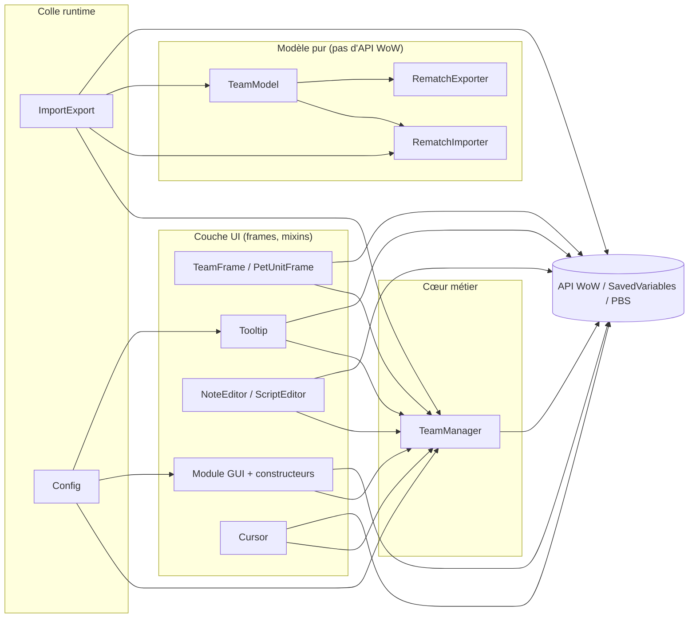
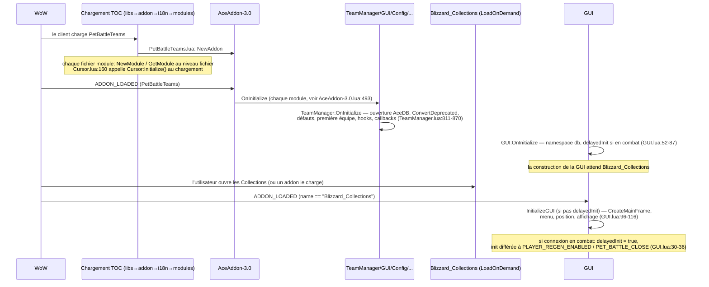

# PetBattleTeams — Architecture technique

Documentation de référence de l'addon **tel qu'il est implémenté** (version 12.1.503).
Complément d'`AGENTS.md` (règles de travail) et de `backlog.md` (audit du 2026-11-13 : défauts
connus). Chaque affirmation ci-dessous pointe vers des fichiers réels ; les fonctionnalités
prévues mais non implémentées ne sont pas décrites.

## 1. Présentation générale

### 1.1 Objectif et fonctionnalités

PetBattleTeams gère des équipes de 3 mascottes de combat et maintient le loadout de
mascottes synchronisé avec l'équipe sélectionnée. Fonctionnalités implémentées :

| Fonctionnalité                                                            | Où                                                                                                             |
| ------------------------------------------------------------------------- | -------------------------------------------------------------------------------------------------------------- |
| CRUD des équipes (créer/supprimer/renommer/verrouiller)                   | `modules/TeamManager.lua`, menu dans `classes/PetUnitFrame.lua`                                                |
| Application du loadout (mascottes + compétences, pas à pas)               | `TeamManager.lua:40-125` (stepper `OnUpdate`)                                                                  |
| Auto-enregistrement des changements de loadout dans l'équipe sélectionnée | `TeamManager.lua:739-761`, hooké sur `C_PetJournal.SetPetLoadOutInfo`/`SetAbility` (`TeamManager.lua:864-865`) |
| Liste des équipes + détail équipe sélectionnée + glisser-déposer          | `modules/GUI/ScrollFrame.lua`, `classes/TeamFrame.lua`, `classes/PetUnitFrame.lua`, `modules/Cursor.lua`       |
| Notes par équipe (éditeur + affichage en combat)                          | `modules/GUI/NoteEditor.lua`                                                                                   |
| Scripts PBS par équipe (addon externe)                                    | `modules/GUI/ScriptEditor.lua`                                                                                 |
| Import/export compatible Rematch                                          | `modules/RematchImporter.lua`, `RematchExporter.lua`, `TeamModel.lua`, `ImportExport.lua`                      |
| Changement d'équipe auto sur le NPC ciblé                                 | `TeamManager.lua:162-197` (`DetectTarget`), piloté depuis `GUI.lua:38-42`                                      |
| Tooltips mascottes (stats, lignées, fort/faible)                          | `modules/Tooltip.lua`                                                                                          |
| Interface d'options + menu déroulant rapide                               | `modules/Config.lua`, `modules/GUI/MenuButton.lua`                                                             |
| Boutons d'action sécurisés Réanimer / Pansement                           | `modules/GUI/ReviveButton.lua`, `modules/GUI/PetBandageButton.lua`                                             |

### 1.2 Clients supportés

- `## Interface: 120100, 120105, 120107` (retail 12.x) et `50504` (Mists of Pandaria
  Classic) — `PetBattleTeams/PetBattleTeams.toc:1`.
- `## AllowLoadGameType: standard, mists` (TOC ligne 2) : le même code tourne sur les deux
  types de jeu.
- Les fichiers de langue sont filtrés par langue client avec `## AllowLoadTextLocale`
  (lignes 64-71 du TOC).

### 1.3 Technologies et dépendances

- Lua 5.1 dans le client WoW (LuaJIT sur retail) ; UI construite en Lua (aucun XML
  first-party).
- Sous-ensemble Ace3 via LibStub : AceAddon-3.0, AceConfig-3.0 (+Cmd/Dialog/Registry),
  AceConsole-3.0, AceDB-3.0, AceGUI-3.0 (chargé), CallbackHandler-1.0.
- LibPetJournal-2.0 (fork KaspOu), LibPetBreedInfo-1.0, LibDropDownMenu (menus).
- Chargés mais non référencés par le code first-party : LibSharedMedia-3.0, EmbedHandler-1.0
  (également inutilisés : les doublons de niveau supérieur AceGUI-3.0 et AceConfigDialog-3.0
  sous `libs/`).
- Optionnel : l'addon externe `tdBattlePetScript` (« Pet Battle Scripts », nom AceAddon
  `PetBattleScripts`) — voir §3.5.
- Packaging : BigWigs WoW packager (`../packager/release.sh`, manifeste `.pkgmeta`).

## 2. Structure de l'addon

### 2.1 Arborescence (commentée)

```
PetBattleTeams/                     # dossier de l'addon (nom = nom dans le TOC)
├── PetBattleTeams.toc              # métadonnées + ordre de chargement (source de vérité)
├── PetBattleTeams.lua              # objet addon, slash, StaticPopups, métable L
├── i18n/
│   ├── Localization.en.lua         # table de base (clés = chaînes anglaises)
│   └── Localization.{de,es,fr,it,ko,pt,ru,zh}.lua   # traductions (garde : ForceEnglish)
├── modules/
│   ├── TeamManager.lua             # module de données cœur (équipes, loadout, autoswitch, SV)
│   ├── RematchImporter.lua         # parseur pur : chaîne Rematch -> enregistrements
│   ├── RematchExporter.lua         # sérialiseur pur : enregistrement -> chaîne Rematch
│   ├── TeamModel.lua               # enregistrements <-> tables d'équipe, politique de fusion
│   ├── ImportExport.lua            # colle API jeu + dialogue import/export
│   ├── TeamManagerUnitTests.lua    # tests in-game (livrés, manuels uniquement)
│   ├── Tooltip.lua                 # tooltip mascotte custom (PetBattleUnitTooltipTemplate)
│   ├── Cursor.lua                  # machine à états drag + frame de suivi du curseur
│   ├── Config.lua                  # options AceConfig + source du menu déroulant
│   ├── Tutorial.lua                # MORT : absent du TOC, dépend de CustomTutorials-2.0 non livré
│   └── GUI/
│       ├── GUI.lua                 # module GUI : orchestration de l'init, colle options
│       ├── MainFrame.lua           # constructeur de la frame principale + logique de masquage en combat
│       ├── ScrollFrame.lua         # liste des équipes (lignes FauxScrollFrame)
│       ├── NoteEditor.lua          # dialogue éditeur de note + frame de note en combat
│       ├── ScriptEditor.lua        # éditeur de scripts PBS + auto-chargement en combat
│       ├── AddTeamButton.lua, MenuButton.lua, resizer.lua, PetBandageButton.lua,
│       │   ReviveButton.lua        # boutons de contrôle (Réanimer/Pansement sont sécurisés)
│       ├── LockTeamsButton.lua     # MORT : GUI:CreateLockTeamsButton jamais appelé
│       └── DescriptionEditor .lua  # MORT : fichier vide (0 ligne), nom contenant un espace
└── libs/                           # bibliothèques vendored (amont ; voir .pkgmeta)
```

Ne fait pas partie du chargement de l'addon : `../.context/` (outillage dev), `../.pkgmeta`,
`../.release*.bat`.

### 2.2 Rôle des fichiers

- **`PetBattleTeams.lua`** — `LibStub("AceAddon-3.0"):NewAddon("PetBattleTeams")` (ligne 1) ;
  helper mixin `PetBattleTeams.Embed` (13-18) ; gestionnaire slash `/pbt` (21-92) ;
  définitions `StaticPopupDialogs`
  `PBT_TEAM_DELETE/RENAME/EDITNPCID/IMPORT_TEAMS/RESET_TEAMS/SCRIPT_NOTLOADED/SCRIPT_ERROR`
  (95-257) ; métable de localisation `L` + `RegisterLocale` (263-297).
- **`modules/TeamManager.lua`** — le cœur métier : tables d'équipes, API
  `GetPetInfo`/`SetTeam*`, états de verrouillage, tri, cache d'ID NPC et autoswitch
  (`DetectTarget`), stepper `OnUpdate` du loadout (40-125), auto-save par `hooksecurefunc`,
  défauts AceDB et migration `ConvertDeprecated`.
- **Chaîne de modèle** (`RematchImporter` → `RematchExporter` → `TeamModel`) — Lua pur, aucune
  API WoW (les appels jeu sont injectés sous forme de table `api`, `TeamModel.lua:8-13`).
  L'import parse les chaînes d'équipe Rematch (`Name:npcIDs:tag:tag:tag:…`),
  `TeamModel.Merge` applique la politique de conflit (`skip`/`overwrite`/`copy`), l'export
  resérialise.
- **`modules/ImportExport.lua`** — fournit le `api` adossé au jeu, appelle
  `TeamManager:SortTeamsByName/RebuildNpcIDCache`, possède le dialogue de collage
  (`PetBattleTeamsImportExportFrame`, `UISpecialFrames`).
- **`classes/TeamFrame.lua`** — classe mixin `PetBattleTeamsFrame` : une ligne d'équipe
  (3 emplacements de mascotte, texte de nom, icônes note/NPC/script, surcouche de
  déplacement). Exportée en `PetBattleTeams.PetBattleTeamsFrame` (ligne 277).
- **`classes/PetUnitFrame.lua`** — classe mixin `PetBattleTeamsUnitFrame` : un emplacement de
  mascotte (template `PetBattleMiniUnitFrameAlly`), gestionnaires clic/drag/drop, menu équipe
  clic-droit (LibDropDownMenu), câblage du tooltip.
- **`modules/GUI/GUI.lua`** — module GUI : initialisation différée (§4), état
  attach/lock/minimize, visibilité des composants, enregistrement Addon Compartment (223-234).
- **`modules/GUI/MainFrame.lua`** — construit la frame principale `PetBattleTeamFrame`, ses
  contrôles et leur gestion d'événements (masquage/attach en combat).
- **`modules/GUI/ScrollFrame.lua`** — liste : `RosterFrame` de lignes recyclées
  `PetBattleTeamsFrame` sur un scroll frame `FauxScrollFrameTemplate`.
- **`modules/GUI/NoteEditor.lua`** — éditeur de note modal + surcouche `battleFrame` affichée
  pendant les combats de mascottes.
- **`modules/GUI/ScriptEditor.lua`** — éditeur de scripts PBS ; valide via
  `ScriptClass:SetCode` à l'enregistrement ; auto-charge le script de l'équipe sélectionnée au
  début du combat.
- **`modules/Cursor.lua`** — machine à états glisser-déposer (`COPY`/`SWAP`/`MOVE TEAM`) avec
  une frame flottante de timer ; émet `BATTLE_PET_CURSOR_CHANGED`.
- **`modules/Tooltip.lua`** — `PetBattleTeamsTooltip` (template
  `PetBattleUnitTooltipTemplate`) : stats, lueur de rareté, lignée (LibPetBreedInfo), indices
  fort/faible, texte d'aide.
- **`modules/Config.lua`** — groupe AceConfig (voir §6.4) ; construit le menu déroulant rapide
  via `GetEasyMenu` (361-409) consommé par `MenuButton`.

### 2.3 Configuration du TOC

Directives clés (`PetBattleTeams.toc`) :

| Directive                                                  | Valeur                                     | Signification                                           |
| ---------------------------------------------------------- | ------------------------------------------ | ------------------------------------------------------- |
| `Interface`                                                | `120100, 120105, 120107, 50504`            | retail 12.x + MoP Classic                               |
| `AllowLoadGameType`                                        | `standard, mists`                          | les deux types de jeu                                   |
| `DefaultState` / `LoadOnDemand`                            | `Enabled` / `0`                            | toujours chargé                                         |
| `LoadSavedVariablesFirst`                                  | `1`                                        | SV disponibles avant l'exécution des fichiers (11.1.5+) |
| `SavedVariables`                                           | `PetBattleTeamsDB, PetBattleTeamsSettings` | au niveau du compte                                     |
| `AllowLoadTextLocale`                                      | par fichier i18n                           | traductions filtrées par locale                         |
| `IconTexture`, `X-*`, `Title`/`Notes`/`Category` localisés | —                                          | métadonnées de présentation                             |

Aucun `SavedVariablesPerCharacter` n'est utilisé.

### 2.4 Ordre de chargement

L'ordre du TOC (lignes 50-96) se regroupe : libs (XML) → `PetBattleTeams.lua` → i18n →
modules cœur → chaîne de modèle → classes GUI → sous-fichiers GUI. Contraintes d'ordre
impératives :

1. `PetBattleTeams.lua` en premier (crée l'addon et `addon.L`).
2. i18n avant les modules qui lisent `L` au niveau fichier (tous).
3. `TeamManager.lua` avant tout `GetModule("TeamManager")` au niveau fichier.
4. `RematchImporter.lua` → `RematchExporter.lua` → `TeamModel.lua` → `ImportExport.lua`
   (chacun lie `ns.<X>` au niveau fichier).
5. `classes/TeamFrame.lua` (définit `PetBattleTeams.PetBattleTeamsFrame`) avant
   `modules/GUI/ScrollFrame.lua` (qui le lie au niveau fichier, ligne 6).

## 3. Architecture logicielle

### 3.1 Couches



### 3.2 Carte des modules

| Objet                                          | Type                 | Enregistré en                           | Responsabilités                        |
| ---------------------------------------------- | -------------------- | --------------------------------------- | -------------------------------------- |
| `PetBattleTeams`                               | AceAddon             | `PetBattleTeams.lua:1`                  | racine, slash, popups, `L`             |
| `TeamManager`                                  | module               | `TeamManager.lua:25`                    | données, loadout, autoswitch, SV       |
| `GUI`                                          | module               | `GUI.lua:12`                            | cycle de vie GUI, état des options     |
| `Config`                                       | module (+AceConsole) | `Config.lua:2`                          | table d'options, menus                 |
| `Tooltip`                                      | module               | `Tooltip.lua:2`                         | tooltip mascotte                       |
| `Cursor`                                       | module               | `Cursor.lua:11`                         | état drag, événements curseur          |
| `NoteEditor`                                   | module               | `NoteEditor.lua:2`                      | UI des notes                           |
| `ScriptEditor`                                 | module               | `ScriptEditor.lua:2`                    | intégration PBS                        |
| `ImportExport`                                 | module               | `ImportExport.lua:15`                   | dialogue import/export                 |
| `PetBattleTeamsFrame`                          | classe mixin         | `TeamFrame.lua:277`                     | widget ligne d'équipe                  |
| `PetBattleTeamsUnitFrame`                      | classe mixin         | `PetUnitFrame.lua:8`                    | widget emplacement mascotte            |
| `ns.RematchImporter/RematchExporter/TeamModel` | modèle pur           | `modules/Rematch*.lua`, `TeamModel.lua` | format de chaîne + politique de fusion |
| `TeamManagerUnitTests`                         | table sur l'addon    | `TeamManagerUnitTests.lua:3`            | tests manuels                          |

### 3.3 Communication entre modules

Diffuseurs CallbackHandler-1.0 :

| Diffuseur               | Événement                                                           | Émis par                                         | Abonnés (nom de méthode)                                                                               |
| ----------------------- | ------------------------------------------------------------------- | ------------------------------------------------ | ------------------------------------------------------------------------------------------------------ |
| `TeamManager.callbacks` | `TEAM_UPDATED` (optionnel `teamIndex`)                              | la plupart des mutateurs, `ImportExport.lua:140` | `PetBattleTeamsFrame:TEAM_UPDATED`, `PetBattleTeamsUnitFrame:TEAM_UPDATED`, `RosterFrame:TEAM_UPDATED` |
|                         | `TEAM_CREATED` (index)                                              | `TeamManager:CreateTeam` (`:715`)                | `RosterFrame:TEAM_CREATED`                                                                             |
|                         | `TEAM_DELETED` (index)                                              | `TeamManager:DeleteTeam` (`:735`)                | `PetBattleTeamsFrame:TEAM_DELETED`, `RosterFrame:TEAM_DELETED`                                         |
|                         | `SELECTED_TEAM_CHANGED` (index)                                     | `TeamManager:SetSelected` (`:528`)               | `PetBattleTeamsFrame:SELECTED_TEAM_CHANGED`, widget `MainFrame` (`MainFrame.lua:192`)                  |
| `Cursor.callbacks`      | `BATTLE_PET_CURSOR_CHANGED` (operation, petID, teamIndex, petIndex) | `Cursor.lua:57/112/137/153`                      | `TeamManager:BATTLE_PET_CURSOR_CHANGED` (`:920`), `PetBattleTeamsFrame` (`TeamFrame.lua:268`)          |
| `GUI.callbacks`         | `OPTIONS_UPDATE`                                                    | `GUI:SetLocked` (`GUI.lua:146`)                  | `RosterFrame` (`ScrollFrame.lua:98-99`)                                                                |
| `LibPetJournal` (lib)   | `PetListUpdated`                                                    | bibliothèque                                     | `TeamManager:setupSpeciesIDRunOnce` (`:869`)                                                           |

Il n'existe **aucun** canal de communication par chat/messages d'addons (`C_ChatInfo`
inutilisé).

### 3.4 Conventions de namespaces et de globales

- Une seule table d'addon (`PetBattleTeams`) ; modules via `NewModule` ; classes de widgets
  mixées avec `PetBattleTeams.Embed` (`PetBattleTeams.lua:13-18`) — les instances reçoivent une
  copie de la table de méthodes de la classe à l'appel de `New()`.
- Table vararg privée par fichier (`local _, addon = ...`) : porte `L` et les fichiers de
  modèle.
- Des globales nommées uniquement pour les frames qui en ont besoin (`PetBattleTeamFrame`,
  `PetBattleTeamsTooltip`, `PetBattleTeamsImportExportFrame`, `CursorTeamFrame` — ces deux
  dernières dans `UISpecialFrames` pour la fermeture par Échap) et les globales `SLASH_*`.

### 3.5 Intégration d'addon externe (Pet Battle Scripts)

`ScriptEditor.lua` s'intègre avec l'addon optionnel `tdBattlePetScript` :

- Détection : `C_AddOns.IsAddOnLoaded("tdBattlePetScript")` à l'init, ou `ADDON_LOADED` avec
  `name == "tdBattlePetScript"` plus tard (`ScriptEditor.lua:30-34`, `:54`).
- Contrat : `LibStub("AceAddon-3.0"):GetAddon("PetBattleScripts")` → `GetModule("Director")`,
  `GetClass("Script")` ; `ScriptClass:New({code=…})` + `:SetCode(code)` (validation),
  `Director:SetScript(scriptObject)` (`:238-258`).
- Flux : validation à l'enregistrement (`:221-227`), poussée automatique du script de
  l'équipe sélectionnée à `PET_BATTLE_OPENING_START` (`:262-271`). Les scripts importés via
  des chaînes d'équipe sont stockés **sans** cette validation (backlog.md constat 1).

## 4. Cycle de vie

Seuls les événements réellement utilisés sont documentés. `PLAYER_LOGIN` et
`PLAYER_ENTERING_WORLD` ne sont **nulle part** utilisés ; `OnEnable` d'AceAddon n'est défini
par aucun module.



Étapes en prose :

1. **Chargement des fichiers** (ordre TOC, §2.4). `Cursor:Initialize()` s'exécute au
   chargement du fichier (`Cursor.lua:160`) — le seul module à faire du travail hors
   `OnInitialize`.
2. **`ADDON_LOADED`** distribue `OnInitialize` d'AceAddon à chaque module
   (`libs/AceAddon-3.0/AceAddon-3.0.lua:493`) : TeamManager ouvre `PetBattleTeamsDB`, migre
   les données, crée la première équipe si besoin, installe les deux hooks `hooksecurefunc` et
   enregistre les callbacks ; GUI/Config/Tooltip/NoteEditor/ScriptEditor construisent leur
   état.
3. **L'initialisation de la GUI est différée** jusqu'au chargement de `Blizzard_Collections`
   (LoadOnDemand) — l'UI de l'addon se parent à `PetJournal` en mode attaché. Les branches de
   récupération gèrent la connexion en combat (`GUI.lua:30-36`, `:77-79`).
4. **Runtime** : les événements de frames (§5) pilotent tout ; aucun travail d'UI au
   login.

## 5. Système d'événements

| Événement                                                                 | Frame / propriétaire                                                                            | Handler                                                    | Comportement                                                                              |
| ------------------------------------------------------------------------- | ----------------------------------------------------------------------------------------------- | ---------------------------------------------------------- | ----------------------------------------------------------------------------------------- |
| `ADDON_LOADED`                                                            | `eventFrame` (`GUI.lua:15,50`)                                                                  | `GUI.lua:21-28`                                            | init GUI au chargement de Blizzard_Collections ; enregistrement Addon Compartment         |
| `ADDON_LOADED`                                                            | `eventsFrame` (`ScriptEditor.lua:66`)                                                           | `ScriptEditor.lua:53-58`                                   | détection du chargement tardif de tdBattlePetScript                                       |
| `PLAYER_REGEN_ENABLED`, `PET_BATTLE_CLOSE`                                | `eventFrame` (`GUI.lua:47-48`)                                                                  | `GUI.lua:30-36`                                            | init GUI différée                                                                         |
| `PLAYER_TARGET_CHANGED`                                                   | `eventFrame` (`GUI.lua:49`)                                                                     | `GUI.lua:38-42`                                            | `TeamManager:DetectTarget()` (autoswitch)                                                 |
| `PLAYER_REGEN_DISABLED`, `PET_BATTLE_OPENING_START`                       | frame principale (`MainFrame.lua:221,223`)                                                      | `MainFrame.lua:27-57`                                      | masquage en combat/en combat de mascotte (détaché + hideInCombat), réattach à regen/close |
| `PLAYER_REGEN_ENABLED`, `PET_BATTLE_CLOSE`, `PLAYER_LEAVING_WORLD`        | frame principale (`MainFrame.lua:222,224,225`)                                                  | idem                                                       | restauration d'état, `SetAttached`                                                        |
| `PET_BATTLE_QUEUE_STATUS`, `PET_BATTLE_OPENING_START`, `PET_BATTLE_CLOSE` | chaque frame d'équipe (`TeamFrame.lua:270-272`)                                                 | `TeamFrame.lua:50-54` → `PET_BATTLE_QUEUE_STATUS` (`:406`) | visuels de verrouillage en file d'attente                                                 |
| `PET_BATTLE_OPENING_START`, `PET_BATTLE_CLOSE`                            | `battleFrame` (`NoteEditor.lua:245-246`)                                                        | `NoteEditor.lua:248-252`                                   | affiche/masque la note en combat                                                          |
| `PET_BATTLE_OPENING_START`, `PET_BATTLE_CLOSE`                            | `eventsFrame` (`ScriptEditor.lua:67-68`)                                                        | `ScriptEditor.lua:59-64`                                   | auto-chargement PBS + bouton éditer le script                                             |
| `PET_JOURNAL_LIST_UPDATE`                                                 | chaque frame unité mascotte (`PetUnitFrame.lua:160`)                                            | `PetUnitFrame.lua:90-95`                                   | rafraîchit le widget mascotte                                                             |
| `PET_JOURNAL_LIST_UPDATE`                                                 | `eventFrame` (`GUI.lua:46`)                                                                     | `GUI.lua:20-43`                                            | enregistré mais aucune branche dans le handler — quasi sans effet                         |
| `BATTLE_PET_CURSOR_CLEAR`                                                 | `eventFrame` de Cursor (`Cursor.lua:68`)                                                        | `Cursor.lua:22-26`                                         | `Cursor:Clear()`                                                                          |
| `SPELL_UPDATE_COOLDOWN`                                                   | boutons Réanimer/Pansement (`ReviveButton.lua:60`, `PetBandageButton.lua:24,67` + `BAG_UPDATE`) | `ReviveButton.lua:12-21`                                   | rafraîchissement recharge + compteur                                                      |
| `PLAYER_REGEN_DISABLED/ENABLED`                                           | bouton Réanimer (`ReviveButton.lua:61-62`)                                                      | handler `ReviveButton.lua`                                 | comportement du bouton sécurisé                                                           |

Gestionnaires `OnUpdate` locaux aux frames (pas des événements) : stepper du loadout
(`TeamManager.lua:40-116`, armé par `ApplyTeam`), timer du curseur (`Cursor.lua:28-49`).

## 6. Interface utilisateur

### 6.1 Arbre des frames


`*` Réanimer/Pansement sont sécurisés (`secureactionbuttontemplate`).

### 6.2 Widgets et templates

Templates réellement utilisés (first-party) : `BackdropTemplate` (via
`BackdropTemplateMixin and "BackdropTemplate"` ou directement),
`PetBattleUnitTooltipTemplate` (Tooltip), `PetBattleMiniUnitFrameAlly` (emplacement
mascotte), `FauxScrollFrameTemplate` (liste), `ScrollFrameTemplate` (défilements des
éditeurs), `UIPanelButtonTemplate`, `UICheckButtonTemplate`, `GameTooltipTemplate`,
`CooldownFrameTemplate` (Réanimer), `secureactionbuttontemplate` (Réanimer/Pansement —
écriture en minuscules comme dans la source). `SetBackdrop`/`SetBackdropColor` sont utilisés
sur des frames `BackdropTemplate` (valide sur les deux clients ciblés).

### 6.3 Interactions

- **Clics** sur un emplacement mascotte : clic gauche sélectionne l'équipe
  (`PetUnitFrame.lua:122-137`), ou complète une opération de curseur en attente
  (`OnReceiveDrag`, `:97-108`) ; clic droit ouvre le menu déroulant d'équipe
  (renommer/note/NPC/supprimer/export/import/verrouiller/retrait mascotte,
  `PetUnitFrame.lua:18-87`).
- **Glisser-déposer** : `OnDragStart` → `Cursor:PickupPet` (états `COPY`/`SWAP`,
  `Cursor.lua:115-139`) ; les lignes d'équipe gèrent `MOVE TEAM` via la surcouche
  `teamMovementFrame` (`TeamFrame.lua:39-48`, `Cursor:PickupTeam` `:73-113`).
- **Liste** : lignes de hauteur fixe avec calcul d'offset `FauxScrollFrame`
  (`ScrollFrame.lua:12-66`).
- **Éditeurs** : les éditeurs Note/Script sont des frames mobiles de strate `DIALOG` ;
  Ctrl+Entrée enregistre, Échap masque (`NoteEditor.lua`, `ScriptEditor.lua:144-153`).
- **UI protégée** : les deux boutons sécurisés portent de vrais attributs — Réanimer
  `type="spell"`, `spell=<nom>` (`ReviveButton.lua:44-46`) ; Pansement `unit="player"`,
  `type="macro"`, `macrotext="/use item:86143"` (`PetBandageButton.lua:37-40`). Toute
  modification doit respecter le combat lockdown.

### 6.4 Système de configuration

- Groupe AceConfig `PetBattleTeams` enregistré dans `Config:OnInitialize`
  (`Config.lua:350-355`) avec `RegisterOptionsTable(..., {"pbt"})` → enregistre aussi `/pbt`
  (collision avec le `/pbt` propre à l'addon, backlog.md constat 6) ; `/pbto` ouvre la
  config autonome (`Config.lua:354`) ; `ACD:AddToBlizOptions` pour le panneau de réglages
  Blizzard.
- Arbre d'options (`Config.lua:27-348`) : `TeamFrameHeading`(1) + showXpInLevel(2),
  showXpInHealth(3), ShowTeamName(4), ShowBattleNote(6), SelectedTeamScrolling(7) ;
  `MainFrameHeading`(50) + AttachToPetJournal(51), HideInCombat(52), LockPosition(53),
  showSelectedTeam(60), showControls(61), showRoster(62) ; `TooltipHeading`(75) +
  ShowHelperText(80), ShowStrongWeakHints(81), ShowBreedInfo(82) ;
  `TeamFunctionsHeading`(97) + AutoSwitchOnTarget(98), SortTeams(99), SaveTeams(100),
  DismissPet(101), ImportTeams(102), ExportTeams(103), UnlockTeams(107), LockAllTeams(108),
  ReconstructTeams(109), ResetTeams(110) ; ResetUI(120) ; en-tête `special`(130) +
  compartmentFilter(131, masqué sans AddonCompartmentFrame), forceEnglish(133).
- `GetEasyMenu` (`Config.lua:361-409`) projette le même arbre en menu LibDropDownMenu
  (toggles → éléments à cocher, en-têtes → titres, exécutions autorisées
  `ImportTeams`/`ExportTeams` selon `MenuOptions` en `:20-23`), utilisé par le clic droit de
  `MenuButton`.

## 7. Persistance

### 7.1 SavedVariables

- **`PetBattleTeamsDB`** — AceDB-3.0 (`TeamManager.lua:835`, `GUI.lua:55`,
  `Tooltip.lua:53` ; la même variable est ouverte trois fois, trois namespaces). Forme stockée :

    ```
    PetBattleTeamsDB = {
        namespaces = {
            TeamManager = { global = { teams = {…}, selected, dismissPet, hasImported,
                userLocked, showTeamName, showBattleNote, showXpInLevel, showXpInHealthBar,
                sortTeams, automaticallySaveTeams, ignoreEmptyPets, autoSwitchOnTarget } },
            GUI         = { global = { attached, locked, hideInCombat, x, y, h,
                showSelectedTeam, showControls, showRoster, minimized,
                SelectedTeamScrolling, compartmentFilter } },
            Tooltip     = { global = { ShowHelpText, ShowStrongWeakHints, ShowBreedInfo } },
        },
        profileKeys = {…}, profiles = { Default = {} },
    }
    ```

- **Enregistrement d'équipe** (élément de `teams`) : `name` (string|nil), `note`, `script`,
  `npcID` (chaîne du type `"12345 (Nom)"`), `enabled = {bool,bool,bool}`, `locked` (bool),
  `rematch` (métadonnées d'import : key, npcIDsRaw, préférences, instantané de notes, tags
  d'emplacement), `[1..3] = { petID ("BattlePet-0-…"), speciesID, abilities = {a1,a2,a3} }`.
- **`PetBattleTeamsSettings`** — table simple, clé unique `ForceEnglish` (lu au chargement du
  fichier i18n, `i18n/localization.*.lua:4` ; écrit par `Config.lua:337-341`).

### 7.2 Défauts, migration, timing

- Les défauts vivent dans les defaults de namespace AceDB de chaque module
  (`TeamManager.lua:816-832`, `GUI.lua:58-73`, `Tooltip.lua:44-50`) ; AceDB remplit les
  clés manquantes à l'ouverture.
- **Migration** — `TeamManager:ConvertDeprecated` (`:764-808`) : `description`→`note` ;
  petIDs numériques → hex `"%0#18x"` → chaînes `BattlePet-0-…` (conversion époque WoD).
- `OnInitialize` normalise aussi `enabled` pour chaque équipe (`:852-857`) et reconstruit le
  cache d'ID NPC (`:130-153`).
- Timing : `## LoadSavedVariablesFirst: 1` (TOC ligne 27) rend les SV disponibles avant
  l'exécution des fichiers sur les clients qui le supportent (11.1.5+ selon
  `docs/WoWAddonDevGuide-master/04_Addon_Structure.md`) ; AceDB est ouvert dans
  `OnInitialize`, qui suit de toute façon l'attribution des globales SV par le client. Les
  écritures ont lieu à la déconnexion par le client (AceDB mutate la table en place).

```mermaid
flowchart LR
  SV[(PetBattleTeamsDB / PetBattleTeamsSettings<br/>fichier SavedVariables)]
  AAW["Ouverture AceDB (OnInitialize,<br/>3 namespaces)"]
  TM[TeamManager.teams<br/>+ settings]
  UI[UI + Config + Import/Export]
  MIG["ConvertDeprecated<br/>+ reset enabled"]
  SV -->|chargement (client, avant/autour de ADDON_LOADED)| AAW --> MIG --> TM
  TM <-->|lecture/écriture runtime| UI
  TM -->|mutation en place| AAW
  AAW -->|sauvegarde à la déconnexion (client)| SV
```

## 8. Utilisation de l'API World of Warcraft

### 8.1 Appels `C_*` first-party

| Namespace      | Fonctions                                                                                                                                                                                      | Utilisé par                                             |
| -------------- | ---------------------------------------------------------------------------------------------------------------------------------------------------------------------------------------------- | ------------------------------------------------------- |
| `C_PetJournal` | `GetPetInfoByPetID`, `GetPetInfoBySpeciesID`, `GetPetAbilityList`, `GetPetStats`, `GetPetLoadOutInfo`, `SetPetLoadOutInfo`, `SetAbility`, `PickupPet`, `GetSummonedPetGUID`, `SummonPetByGUID` | TeamManager, ImportExport, Cursor, Tooltip              |
| `C_PetBattles` | `GetAbilityInfoByID`, `GetPVPMatchmakingInfo`                                                                                                                                                  | Tooltip (compétences), TeamManager (verrou file `:329`) |
| `C_Spell`      | `GetSpellInfo`, `GetSpellCooldown`                                                                                                                                                             | ReviveButton (`:36-39`), PetBandageButton               |
| `C_Item`       | `GetItemIconByID`, `GetItemCount`, `GetItemQualityColor`                                                                                                                                       | PetBandageButton, Tooltip (`:256`)                      |
| `C_AddOns`     | `IsAddOnLoaded`, `GetAddOnMetadata`                                                                                                                                                            | GUI, ScriptEditor, compartment Config                   |
| `C_Timer`      | `After`                                                                                                                                                                                        | NoteEditor, ScriptEditor (défilement vers le bas)       |

### 8.2 Hooks et globales

- Sites `hooksecurefunc` : `C_PetJournal.PickupPet` + `ClearCursor` (`Cursor.lua:69-70`),
  `C_PetJournal.SetPetLoadOutInfo` + `SetAbility` → `TeamManager.UpdateCurrentTeam`
  (`TeamManager.lua:864-865`).
- Globales notables : `StaticPopupDialogs/Show/OnClick`, `SlashCmdList`/`SLASH_*`,
  `DEFAULT_CHAT_FRAME`, `UIErrorsFrame`, `UISpecialFrames`, `GameTooltip`,
  `FauxScrollFrame_*` + `FauxScrollFrameTemplate`, `CooldownFrame_Set`,
  `SetCollectionsJournalShown` + `COLLECTIONS_JOURNAL_TAB_INDEX_PETS`,
  `PetJournal_UpdatePetLoadOut` (garde d'existence, `TeamManager.lua:88`),
  `PetJournalHealPetButton_OnEnter` (repli défini en `ReviveButton.lua:7-10`),
  `IsShift/Control/ModifierKeyDown`, `UnitAffectingCombat`, `InCombatLockdown`,
  `issecretvalue` (garde d'existence).

### 8.3 Restrictions observées dans le code

- Combat : gardes `InCombatLockdown`/`UnitAffectingCombat` dans `GUI:SetAttached`
  (`GUI.lua:119`), `MainFrame:SetAttached` (`MainFrame.lua:99`), `TeamManager:DetectTarget`
  (`:167`), `GUI:InitializeGUI` (`:108`). Les violations de cette règle sur les boutons
  sécurisés sont des défauts connus (backlog.md constats 2-3, 8).
- Secret values (12.x) : gardé dans `DetectTarget` (`TeamManager.lua:175`) ; absent dans
  `SetNpcFromTarget` (`:421-426`) et pour les recharges dans `ReviveButton.lua:14-16`
  (backlog.md constats 4, 13).

## 9. Compatibilité, sécurité et gestion des erreurs

- **Double client** : les chemins de code ne diffèrent que par des gardes d'existence
  (`issecretvalue`, `PetJournal_UpdatePetLoadOut`, `BackdropTemplateMixin`) et le filtrage de
  locale. Questions de compatibilité ouvertes : support de `LoadSavedVariablesFirst` sur 5.5,
  `Frame:GetBoundsRect` (`Tooltip.lua:164`) sur 5.5, formes exactes des tables `C_Spell` sur
  5.5 (couverture backlog.md).
- **Secure execution** : seuls les deux boutons d'action agissent en combat ; les attributs
  sont statiques (posés à la création). Aucun snippet protégé/`SetAttribute` en runtime
  au-delà des défauts connus.
- **Gestion des erreurs** : `pcall` autour du réglage des compétences dans le stepper du
  loadout (`TeamManager.lua:63-80`) et autour de `LibPetBreedInfo.GetBreedByPetID`
  (`ImportExport.lua:29`) ; `assert` largement utilisé sur les setters publics (contrats de
  type) ; la StaticPopup `PBT_SCRIPT_ERROR` signale les scripts invalides. Plusieurs chemins
  non gardés sur SavedVariables corrompues sont catalogués dans backlog.md constats 10, 15.
- **Entrées non fiables** : la principale est les chaînes d'import collées (éventuellement
  reçues d'autres joueurs). Le parseur est sûr contre les nil et valide espèces/compétences
  contre le journal (couche modèle §3.1) ; les scripts portés par les notes contourrent la
  validation PBS (backlog.md constat 1).
- **Incohérences architecturales connues** (détails et sévérité dans `backlog.md`) :
  sentinelles `EMPTY_PET` dupliquées (`Cursor.lua:18` vs `TeamManager.lua:31`), double
  enregistrement de `/pbt`, sémantique de verrouillage non appliquée au renommage/suppression/
  note/NPC, fichiers morts (`DescriptionEditor .lua`, `Tutorial.lua`, `LockTeamsButton.lua`,
  dialogue `PBT_IMPORT_TEAMS`), tests unitaires livrés dans le TOC de production,
  `GetIgnoreEmptyPets` codé en dur.
