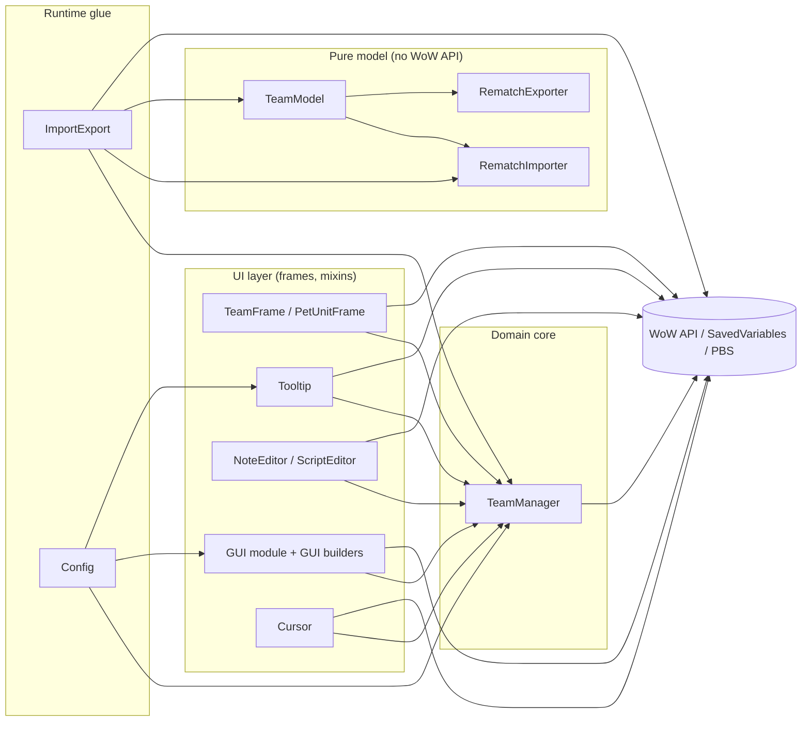
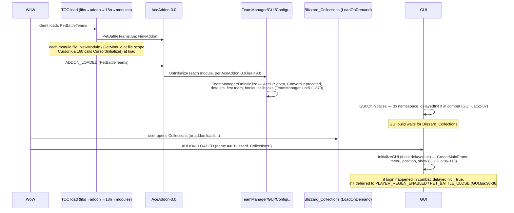
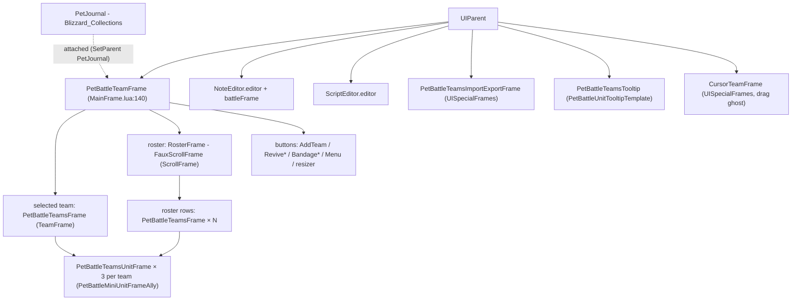

# PetBattleTeams — Technical Architecture

Reference documentation of the addon **as implemented** (version 12.1.503). Companion to
`AGENTS.md` (working rules) and `backlog.md` (2026-11-13 audit: known defects). Every claim
below points at real files; planned-but-unimplemented features are not described.

## 1. Overview

### 1.1 Purpose and features

PetBattleTeams manages teams of 3 battle pets and keeps the pet loadout in sync with the
selected team. Implemented features:

| Feature                                             | Where                                                                                                          |
| --------------------------------------------------- | -------------------------------------------------------------------------------------------------------------- |
| Team CRUD (create/delete/rename/lock)               | `modules/TeamManager.lua`, menu in `classes/PetUnitFrame.lua`                                                  |
| Loadout applying (pets + abilities, stepwise)       | `TeamManager.lua:40-125` (`OnUpdate` stepper)                                                                  |
| Auto-save of loadout changes into the selected team | `TeamManager.lua:739-761`, hooked on `C_PetJournal.SetPetLoadOutInfo`/`SetAbility` (`TeamManager.lua:864-865`) |
| Team roster UI + selected-team detail + drag/drop   | `modules/GUI/ScrollFrame.lua`, `classes/TeamFrame.lua`, `classes/PetUnitFrame.lua`, `modules/Cursor.lua`       |
| Per-team notes (editor + in-battle display)         | `modules/GUI/NoteEditor.lua`                                                                                   |
| Per-team PBS scripts (external addon)               | `modules/GUI/ScriptEditor.lua`                                                                                 |
| Rematch-compatible import/export                    | `modules/RematchImporter.lua`, `RematchExporter.lua`, `TeamModel.lua`, `ImportExport.lua`                      |
| Autoswitch team on target NPC                       | `TeamManager.lua:162-197` (`DetectTarget`), driven from `GUI.lua:38-42`                                        |
| Pet tooltips (stats, breeds, strong/weak)           | `modules/Tooltip.lua`                                                                                          |
| Options UI + dropdown quick menu                    | `modules/Config.lua`, `modules/GUI/MenuButton.lua`                                                             |
| Revive / bandage secure action buttons              | `modules/GUI/ReviveButton.lua`, `modules/GUI/PetBandageButton.lua`                                             |

### 1.2 Supported clients

- `## Interface: 120100, 120105, 120107` (retail 12.x) and `50504` (Mists of Pandaria
  Classic) — `PetBattleTeams/PetBattleTeams.toc:1`.
- `## AllowLoadGameType: standard, mists` (TOC line 2): the same code runs on both game types.
- Locale files are gated per client language with `## AllowLoadTextLocale` (TOC lines 64-71).

### 1.3 Technologies and dependencies

- Lua 5.1 in the WoW client (LuaJIT on retail); UI built in Lua code (no first-party XML).
- Ace3 subset via LibStub: AceAddon-3.0, AceConfig-3.0 (+Cmd/Dialog/Registry), AceConsole-3.0,
  AceDB-3.0, AceGUI-3.0 (loaded), CallbackHandler-1.0.
- LibPetJournal-2.0 (KaspOu fork), LibPetBreedInfo-1.0, LibDropDownMenu (menus).
- Loaded but unreferenced by first-party code: LibSharedMedia-3.0, EmbedHandler-1.0
  (also unused: AceGUI-3.0 and AceConfigDialog-3.0 top-level duplicates under `libs/`).
- Optional: the external addon `tdBattlePetScript` ("Pet Battle Scripts", AceAddon name
  `PetBattleScripts`) — see §3.5.
- Packaging: BigWigs WoW packager (`../packager/release.sh`, manifest `.pkgmeta`).

## 2. Addon structure

### 2.1 Tree (annotated)

```
PetBattleTeams/                     # addon folder (name = addon name in the TOC)
├── PetBattleTeams.toc              # metadata + load order (source of truth)
├── PetBattleTeams.lua              # addon object, slash handler, StaticPopups, L metatable
├── i18n/
│   ├── Localization.en.lua         # base table (keys = English strings)
│   └── Localization.{de,es,fr,it,ko,pt,ru,zh}.lua   # translations (guard: ForceEnglish)
├── modules/
│   ├── TeamManager.lua             # core data module (teams, loadout, autoswitch, SV)
│   ├── RematchImporter.lua         # pure parser: Rematch string -> records
│   ├── RematchExporter.lua         # pure serializer: record -> Rematch string
│   ├── TeamModel.lua               # records <-> team tables, merge/import policy
│   ├── ImportExport.lua            # game API glue + import/export dialog
│   ├── TeamManagerUnitTests.lua    # in-game tests (shipped, manual only)
│   ├── Tooltip.lua                 # custom pet tooltip (PetBattleUnitTooltipTemplate)
│   ├── Cursor.lua                  # drag-state machine + cursor follow frame
│   ├── Config.lua                  # AceConfig options + dropdown menu source
│   ├── Tutorial.lua                # DEAD: not in TOC, needs unshipped CustomTutorials-2.0
│   └── GUI/
│       ├── GUI.lua                 # GUI module: init orchestration, options glue
│       ├── MainFrame.lua           # main frame builder + combat hide logic
│       ├── ScrollFrame.lua         # team roster (FauxScrollFrame rows)
│       ├── NoteEditor.lua          # note editor dialog + in-battle note frame
│       ├── ScriptEditor.lua        # PBS script editor + battle auto-load
│       ├── AddTeamButton.lua, MenuButton.lua, resizer.lua, PetBandageButton.lua,
│       │   ReviveButton.lua        # control buttons (Revive/Bandage are secure)
│       ├── LockTeamsButton.lua     # DEAD: GUI:CreateLockTeamsButton never called
│       └── DescriptionEditor .lua  # DEAD: empty file (0 lines), name contains a space
└── libs/                           # vendored libraries (upstream; see .pkgmeta externals)
```

Not part of the addon load: `../.context/` (dev tooling), `../.pkgmeta`, `../.release*.bat`.

### 2.2 File roles

- **`PetBattleTeams.lua`** — `LibStub("AceAddon-3.0"):NewAddon("PetBattleTeams")` (line 1);
  `PetBattleTeams.Embed` mixin helper (13-18); `/pbt` slash handler (21-92); `StaticPopupDialogs`
  definitions `PBT_TEAM_DELETE/RENAME/EDITNPCID/IMPORT_TEAMS/RESET_TEAMS/SCRIPT_NOTLOADED/
SCRIPT_ERROR` (95-257); localization `L` metatable + `RegisterLocale` (263-297).
- **`modules/TeamManager.lua`** — the domain core: team tables, `GetPetInfo`/`SetTeam*` API,
  lock states, sorting, NPC-ID cache and autoswitch (`DetectTarget`), the `OnUpdate` loadout
  stepper (40-125), `hooksecurefunc` auto-save, AceDB defaults and `ConvertDeprecated` migration.
- **Model chain** (`RematchImporter` → `RematchExporter` → `TeamModel`) — pure Lua, no WoW API
  (game calls are injected as an `api` table, `TeamModel.lua:8-13`). Import parses Rematch team
  strings (`Name:npcIDs:tag:tag:tag:…`), `TeamModel.Merge` applies the conflict policy
  (`skip`/`overwrite`/`copy`), export re-serializes.
- **`modules/ImportExport.lua`** — supplies the game-backed `api`, calls
  `TeamManager:SortTeamsByName/RebuildNpcIDCache`, owns the paste dialog
  (`PetBattleTeamsImportExportFrame`, `UISpecialFrames`).
- **`classes/TeamFrame.lua`** — mixin class `PetBattleTeamsFrame`: one team row (3 pet slots,
  name text, note/NPC/script icons, drag-move overlay). Exported as
  `PetBattleTeams.PetBattleTeamsFrame` (line 277).
- **`classes/PetUnitFrame.lua`** — mixin class `PetBattleTeamsUnitFrame`: one pet slot
  (template `PetBattleMiniUnitFrameAlly`), click/drag/drop handlers, right-click team menu
  (LibDropDownMenu), tooltip wiring.
- **`modules/GUI/GUI.lua`** — GUI module: deferred initialization (§4), attach/lock/minimize
  state, component visibility, Addon Compartment registration (223-234).
- **`modules/GUI/MainFrame.lua`** — builds the main frame `PetBattleTeamFrame`, its controls
  and event handling (combat hide/attach).
- **`modules/GUI/ScrollFrame.lua`** — roster: `RosterFrame` of recycled
  `PetBattleTeamsFrame` rows on a `FauxScrollFrameTemplate` scroll frame.
- **`modules/GUI/NoteEditor.lua`** — modal note editor + `battleFrame` overlay shown during
  pet battles.
- **`modules/GUI/ScriptEditor.lua`** — PBS script editor; validates via PBS
  `ScriptClass:SetCode` on save; auto-loads the selected team's script at battle start.
- **`modules/Cursor.lua`** — drag-and-drop state machine (`COPY`/`SWAP`/`MOVE TEAM`) with a
  floating timer frame; fires `BATTLE_PET_CURSOR_CHANGED`.
- **`modules/Tooltip.lua`** — `PetBattleTeamsTooltip` (template
  `PetBattleUnitTooltipTemplate`): stats, rarity glow, breed (LibPetBreedInfo), strong/weak
  hints, help text.
- **`modules/Config.lua`** — AceConfig group (see §6.4); builds the dropdown quick menu via
  `GetEasyMenu` (361-409) consumed by `MenuButton`.

### 2.3 TOC configuration

Key directives (`PetBattleTeams.toc`):

| Directive                                                  | Value                                      | Meaning                                      |
| ---------------------------------------------------------- | ------------------------------------------ | -------------------------------------------- |
| `Interface`                                                | `120100, 120105, 120107, 50504`            | retail 12.x + MoP Classic                    |
| `AllowLoadGameType`                                        | `standard, mists`                          | both game types                              |
| `DefaultState` / `LoadOnDemand`                            | `Enabled` / `0`                            | always loaded                                |
| `LoadSavedVariablesFirst`                                  | `1`                                        | SV available before file execution (11.1.5+) |
| `SavedVariables`                                           | `PetBattleTeamsDB, PetBattleTeamsSettings` | account-wide                                 |
| `AllowLoadTextLocale`                                      | per i18n file                              | locale-gated translations                    |
| `IconTexture`, `X-*`, localized `Title`/`Notes`/`Category` | —                                          | presentation metadata                        |

No `SavedVariablesPerCharacter` is used.

### 2.4 Load order

TOC order (lines 50-96) groups: libs (XML) → `PetBattleTeams.lua` → i18n → core modules →
model chain → GUI classes → GUI sub-files. Hard ordering constraints:

1. `PetBattleTeams.lua` first (creates the addon and `addon.L`).
2. i18n before modules that read `L` at file scope (all of them).
3. `TeamManager.lua` before any `GetModule("TeamManager")` at file scope.
4. `RematchImporter.lua` → `RematchExporter.lua` → `TeamModel.lua` → `ImportExport.lua`
   (each binds `ns.<X>` at file scope).
5. `classes/TeamFrame.lua` (defines `PetBattleTeams.PetBattleTeamsFrame`) before
   `modules/GUI/ScrollFrame.lua` (binds it at file scope, line 6).

## 3. Software architecture

### 3.1 Layers



### 3.2 Module map

| Object                                         | Kind                 | Registered at                           | Responsibilities              |
| ---------------------------------------------- | -------------------- | --------------------------------------- | ----------------------------- |
| `PetBattleTeams`                               | AceAddon             | `PetBattleTeams.lua:1`                  | root, slash, popups, `L`      |
| `TeamManager`                                  | module               | `TeamManager.lua:25`                    | data, loadout, autoswitch, SV |
| `GUI`                                          | module               | `GUI.lua:12`                            | GUI lifecycle, options state  |
| `Config`                                       | module (+AceConsole) | `Config.lua:2`                          | options table, menus          |
| `Tooltip`                                      | module               | `Tooltip.lua:2`                         | pet tooltip                   |
| `Cursor`                                       | module               | `Cursor.lua:11`                         | drag state, cursor events     |
| `NoteEditor`                                   | module               | `NoteEditor.lua:2`                      | notes UI                      |
| `ScriptEditor`                                 | module               | `ScriptEditor.lua:2`                    | PBS integration               |
| `ImportExport`                                 | module               | `ImportExport.lua:15`                   | import/export dialog          |
| `PetBattleTeamsFrame`                          | mixin class          | `TeamFrame.lua:277`                     | team row widget               |
| `PetBattleTeamsUnitFrame`                      | mixin class          | `PetUnitFrame.lua:8`                    | pet slot widget               |
| `ns.RematchImporter/RematchExporter/TeamModel` | pure model           | `modules/Rematch*.lua`, `TeamModel.lua` | string format + merge policy  |
| `TeamManagerUnitTests`                         | table on addon       | `TeamManagerUnitTests.lua:3`            | manual tests                  |

### 3.3 Inter-module communication

CallbackHandler-1.0 dispatchers:

| Dispatcher              | Event                                                               | Fired by                              | Subscribers (method name)                                                                              |
| ----------------------- | ------------------------------------------------------------------- | ------------------------------------- | ------------------------------------------------------------------------------------------------------ |
| `TeamManager.callbacks` | `TEAM_UPDATED` (optional `teamIndex`)                               | most mutators, `ImportExport.lua:140` | `PetBattleTeamsFrame:TEAM_UPDATED`, `PetBattleTeamsUnitFrame:TEAM_UPDATED`, `RosterFrame:TEAM_UPDATED` |
|                         | `TEAM_CREATED` (index)                                              | `TeamManager:CreateTeam` (`:715`)     | `RosterFrame:TEAM_CREATED`                                                                             |
|                         | `TEAM_DELETED` (index)                                              | `TeamManager:DeleteTeam` (`:735`)     | `PetBattleTeamsFrame:TEAM_DELETED`, `RosterFrame:TEAM_DELETED`                                         |
|                         | `SELECTED_TEAM_CHANGED` (index)                                     | `TeamManager:SetSelected` (`:528`)    | `PetBattleTeamsFrame:SELECTED_TEAM_CHANGED`, `MainFrame` widget (`MainFrame.lua:192`)                  |
| `Cursor.callbacks`      | `BATTLE_PET_CURSOR_CHANGED` (operation, petID, teamIndex, petIndex) | `Cursor.lua:57/112/137/153`           | `TeamManager:BATTLE_PET_CURSOR_CHANGED` (`:920`), `PetBattleTeamsFrame` (`TeamFrame.lua:268`)          |
| `GUI.callbacks`         | `OPTIONS_UPDATE`                                                    | `GUI:SetLocked` (`GUI.lua:146`)       | `RosterFrame` (`ScrollFrame.lua:98-99`)                                                                |
| `LibPetJournal` (lib)   | `PetListUpdated`                                                    | library                               | `TeamManager:setupSpeciesIDRunOnce` (`:869`)                                                           |

There is **no** chat/addon-message channel (`C_ChatInfo` unused).

### 3.4 Namespace and global conventions

- One addon table (`PetBattleTeams`); modules via `NewModule`; widget classes mixed in with
  `PetBattleTeams.Embed` (`PetBattleTeams.lua:13-18`) — instances get a copy of the class
  method table at `New()` time.
- Private vararg table per file (`local _, addon = ...`): carries `L` and the model files.
- Named globals only for frames that need them (`PetBattleTeamFrame`,
  `PetBattleTeamsTooltip`, `PetBattleTeamsImportExportFrame`, `CursorTeamFrame` — the last two
  in `UISpecialFrames` for Esc-close) and the `SLASH_*` globals.

### 3.5 External addon integration (Pet Battle Scripts)

`ScriptEditor.lua` integrates with the optional `tdBattlePetScript`:

- Detection: `C_AddOns.IsAddOnLoaded("tdBattlePetScript")` at init, or `ADDON_LOADED` with
  `name == "tdBattlePetScript"` later (`ScriptEditor.lua:30-34`, `:54`).
- Contract: `LibStub("AceAddon-3.0"):GetAddon("PetBattleScripts")` → `GetModule("Director")`,
  `GetClass("Script")`; `ScriptClass:New({code=…})` + `:SetCode(code)` (validation),
  `Director:SetScript(scriptObject)` (`:238-258`).
- Flow: validate on save (`:221-227`), auto-push the selected team's script at
  `PET_BATTLE_OPENING_START` (`:262-271`). Scripts imported via team strings are stored
  **without** this validation (backlog.md finding 1).

## 4. Lifecycle

Only events actually used are documented. `PLAYER_LOGIN` and `PLAYER_ENTERING_WORLD` are
**not** used anywhere; AceAddon's `OnEnable` is not defined by any module.



Steps in prose:

1. **File load** (TOC order, §2.4). `Cursor:Initialize()` runs at file load
   (`Cursor.lua:160`) — the only module doing work outside `OnInitialize`.
2. **`ADDON_LOADED`** dispatches AceAddon `OnInitialize` to every module
   (`libs/AceAddon-3.0/AceAddon-3.0.lua:493`): TeamManager opens `PetBattleTeamsDB`, migrates
   data, creates the first team if needed, installs the two `hooksecurefunc` hooks and
   registers callbacks; GUI/Config/Tooltip/NoteEditor/ScriptEditor build their state.
3. **GUI initialization is deferred** until `Blizzard_Collections` (LoadOnDemand) is loaded —
   the addon's UI parents to `PetJournal` when attached. Recovery branches handle the
   combat-login case (`GUI.lua:30-36`, `:77-79`).
4. **Runtime**: frame events (§5) drive everything; there is no login-time UI work.

## 5. Event system

| Event                                                                     | Frame / owner                                                                               | Handler                                                    | Behavior                                                                 |
| ------------------------------------------------------------------------- | ------------------------------------------------------------------------------------------- | ---------------------------------------------------------- | ------------------------------------------------------------------------ |
| `ADDON_LOADED`                                                            | `eventFrame` (`GUI.lua:15,50`)                                                              | `GUI.lua:21-28`                                            | init GUI when Blizzard_Collections loads; Addon Compartment registration |
| `ADDON_LOADED`                                                            | `eventsFrame` (`ScriptEditor.lua:66`)                                                       | `ScriptEditor.lua:53-58`                                   | detect tdBattlePetScript late load                                       |
| `PLAYER_REGEN_ENABLED`, `PET_BATTLE_CLOSE`                                | `eventFrame` (`GUI.lua:47-48`)                                                              | `GUI.lua:30-36`                                            | deferred GUI init                                                        |
| `PLAYER_TARGET_CHANGED`                                                   | `eventFrame` (`GUI.lua:49`)                                                                 | `GUI.lua:38-42`                                            | `TeamManager:DetectTarget()` (autoswitch)                                |
| `PLAYER_REGEN_DISABLED`, `PET_BATTLE_OPENING_START`                       | main frame (`MainFrame.lua:221,223`)                                                        | `MainFrame.lua:27-57`                                      | hide in combat/battle (detached + hideInCombat), reattach on regen/close |
| `PLAYER_REGEN_ENABLED`, `PET_BATTLE_CLOSE`, `PLAYER_LEAVING_WORLD`        | main frame (`MainFrame.lua:222,224,225`)                                                    | same                                                       | restore state, `SetAttached`                                             |
| `PET_BATTLE_QUEUE_STATUS`, `PET_BATTLE_OPENING_START`, `PET_BATTLE_CLOSE` | each team frame (`TeamFrame.lua:270-272`)                                                   | `TeamFrame.lua:50-54` → `PET_BATTLE_QUEUE_STATUS` (`:406`) | queue lock visuals                                                       |
| `PET_BATTLE_OPENING_START`, `PET_BATTLE_CLOSE`                            | `battleFrame` (`NoteEditor.lua:245-246`)                                                    | `NoteEditor.lua:248-252`                                   | show/hide in-battle note                                                 |
| `PET_BATTLE_OPENING_START`, `PET_BATTLE_CLOSE`                            | `eventsFrame` (`ScriptEditor.lua:67-68`)                                                    | `ScriptEditor.lua:59-64`                                   | PBS auto-load + edit-script button                                       |
| `PET_JOURNAL_LIST_UPDATE`                                                 | each pet unit frame (`PetUnitFrame.lua:160`)                                                | `PetUnitFrame.lua:90-95`                                   | refresh pet widget                                                       |
| `PET_JOURNAL_LIST_UPDATE`                                                 | `eventFrame` (`GUI.lua:46`)                                                                 | `GUI.lua:20-43`                                            | registered but the handler has no branch for it — effectively a no-op    |
| `BATTLE_PET_CURSOR_CLEAR`                                                 | Cursor `eventFrame` (`Cursor.lua:68`)                                                       | `Cursor.lua:22-26`                                         | `Cursor:Clear()`                                                         |
| `SPELL_UPDATE_COOLDOWN`                                                   | Revive/Bandage buttons (`ReviveButton.lua:60`, `PetBandageButton.lua:24,67` + `BAG_UPDATE`) | `ReviveButton.lua:12-21`                                   | cooldown + count refresh                                                 |
| `PLAYER_REGEN_DISABLED/ENABLED`                                           | Revive button (`ReviveButton.lua:61-62`)                                                    | `ReviveButton.lua` handler                                 | secure-button behavior                                                   |

Frame-local `OnUpdate` handlers (not events): loadout stepper (`TeamManager.lua:40-116`,
armed by `ApplyTeam`), cursor timer (`Cursor.lua:28-49`).

## 6. User interface

### 6.1 Frame tree



`*` Revive/Bandage are secure (`secureactionbuttontemplate`).

### 6.2 Widgets and templates

Templates actually used (first-party): `BackdropTemplate` (via `BackdropTemplateMixin and
"BackdropTemplate"` or plain), `PetBattleUnitTooltipTemplate` (Tooltip),
`PetBattleMiniUnitFrameAlly` (pet slot), `FauxScrollFrameTemplate` (roster),
`ScrollFrameTemplate` (editor scrolls), `UIPanelButtonTemplate`, `UICheckButtonTemplate`,
`GameTooltipTemplate`, `CooldownFrameTemplate` (Revive), `secureactionbuttontemplate`
(Revive/Bandage — lowercase spelling as in the source). `SetBackdrop`/`SetBackdropColor` are
used on `BackdropTemplate` frames (valid on both target clients).

### 6.3 Interactions

- **Clicks** on a pet slot: left-click selects the team (`PetUnitFrame.lua:122-137`), or
  completes a pending cursor operation (`OnReceiveDrag`, `:97-108`); right-click opens the
  team dropdown menu (rename/note/NPC/delete/export/import/lock/remove-pet,
  `PetUnitFrame.lua:18-87`).
- **Drag/drop**: `OnDragStart` → `Cursor:PickupPet` (state `COPY`/`SWAP`, `Cursor.lua:115-139`);
  team rows support `MOVE TEAM` via `teamMovementFrame` overlay (`TeamFrame.lua:39-48`,
  `Cursor:PickupTeam` `:73-113`).
- **Roster**: fixed-height rows with `FauxScrollFrame` offset math (`ScrollFrame.lua:12-66`).
- **Editors**: Note/Script editors are `DIALOG`-strata movable frames; Ctrl+Enter saves,
  Esc hides (`NoteEditor.lua`, `ScriptEditor.lua:144-153`).
- **Protected UI**: the two secure buttons carry real attributes — Revive
  `type="spell"`, `spell=<name>` (`ReviveButton.lua:44-46`); Bandage
  `unit="player"`, `type="macro"`, `macrotext="/use item:86143"`
  (`PetBandageButton.lua:37-40`). Modifications to them must respect combat lockdown.

### 6.4 Configuration system

- AceConfig group `PetBattleTeams` registered in `Config:OnInitialize`
  (`Config.lua:350-355`) with `RegisterOptionsTable(..., {"pbt"})` → also `/pbt` (collision with
  the addon's own `/pbt`, backlog.md finding 6); `/pbto` opens the standalone config
  (`Config.lua:354`); `ACD:AddToBlizOptions` for the Blizzard settings panel.
- Options tree (`Config.lua:27-348`): `TeamFrameHeading`(1) + showXpInLevel(2),
  showXpInHealth(3), ShowTeamName(4), ShowBattleNote(6), SelectedTeamScrolling(7);
  `MainFrameHeading`(50) + AttachToPetJournal(51), HideInCombat(52), LockPosition(53),
  showSelectedTeam(60), showControls(61), showRoster(62); `TooltipHeading`(75) +
  ShowHelperText(80), ShowStrongWeakHints(81), ShowBreedInfo(82);
  `TeamFunctionsHeading`(97) + AutoSwitchOnTarget(98), SortTeams(99), SaveTeams(100),
  DismissPet(101), ImportTeams(102), ExportTeams(103), UnlockTeams(107), LockAllTeams(108),
  ReconstructTeams(109), ResetTeams(110); ResetUI(120); `special` header(130) +
  compartmentFilter(131, hidden without AddonCompartmentFrame), forceEnglish(133).
- `GetEasyMenu` (`Config.lua:361-409`) projects the same tree into a LibDropDownMenu menu
  (toggles → checkable items, headers → titles, whitelisted executes `ImportTeams`/`ExportTeams`
  per `MenuOptions` at `:20-23`), used by `MenuButton` right-click.

## 7. Persistence

### 7.1 SavedVariables

- **`PetBattleTeamsDB`** — AceDB-3.0 (`TeamManager.lua:835`, `GUI.lua:55`, `Tooltip.lua:53`;
  same variable opened three times, three namespaces). Stored shape:

    ```
    PetBattleTeamsDB = {
        namespaces = {
            TeamManager = { global = { teams = {…}, selected, dismissPet, hasImported,
                userLocked, showTeamName, showBattleNote, showXpInLevel, showXpInHealthBar,
                sortTeams, automaticallySaveTeams, ignoreEmptyPets, autoSwitchOnTarget } },
            GUI         = { global = { attached, locked, hideInCombat, x, y, h,
                showSelectedTeam, showControls, showRoster, minimized,
                SelectedTeamScrolling, compartmentFilter } },
            Tooltip     = { global = { ShowHelpText, ShowStrongWeakHints, ShowBreedInfo } },
        },
        profileKeys = {…}, profiles = { Default = {} },
    }
    ```

- **Team record** (element of `teams`): `name` (string|nil), `note`, `script`, `npcID`
  (string like `"12345 (Name)"`), `enabled = {bool,bool,bool}`, `locked` (bool),
  `rematch` (import metadata: key, npcIDsRaw, preferences, notes snapshot, slot tags),
  `[1..3] = { petID ("BattlePet-0-…"), speciesID, abilities = {a1,a2,a3} }`.
- **`PetBattleTeamsSettings`** — plain table, single key `ForceEnglish` (read at i18n file
  load, `i18n/localization.*.lua:4`; written by `Config.lua:337-341`).

### 7.2 Defaults, migration, timing

- Defaults live in each module's AceDB namespace defaults (`TeamManager.lua:816-832`,
  `GUI.lua:58-73`, `Tooltip.lua:44-50`); AceDB fills missing keys on open.
- **Migration** — `TeamManager:ConvertDeprecated` (`:764-808`): `description`→`note`;
  numeric petIDs → `%0#18x` hex → `BattlePet-0-…` strings (WoD-era conversion).
- `OnInitialize` also normalizes `enabled` for every team (`:852-857`) and rebuilds the
  NPC-ID cache (`:130-153`).
- Timing: `## LoadSavedVariablesFirst: 1` (TOC line 27) makes SV available before file
  execution on clients supporting it (11.1.5+ per
  `docs/WoWAddonDevGuide-master/04_Addon_Structure.md`); AceDB is opened in `OnInitialize`,
  which is after the client assigned the SV globals either way. Writes happen at logout by
  the client (AceDB mutates the table in place).

```mermaid
flowchart LR
  SV[(PetBattleTeamsDB / PetBattleTeamsSettings<br/>SavedVariables file)]
  AAW["AceDB open (OnInitialize,<br/>3 namespaces)"]
  TM[TeamManager.teams<br/>+ settings]
  UI[UI + Config + Import/Export]
  MIG["ConvertDeprecated<br/>+ enabled reset"]
  SV -->|load (client, before/around ADDON_LOADED)| AAW --> MIG --> TM
  TM <-->|read/write at runtime| UI
  TM -->|in-place mutation| AAW
  AAW -->|save at logout (client)| SV
```

## 8. World of Warcraft API usage

### 8.1 First-party `C_*` calls

| Namespace      | Functions                                                                                                                                                                                      | Used by                                              |
| -------------- | ---------------------------------------------------------------------------------------------------------------------------------------------------------------------------------------------- | ---------------------------------------------------- |
| `C_PetJournal` | `GetPetInfoByPetID`, `GetPetInfoBySpeciesID`, `GetPetAbilityList`, `GetPetStats`, `GetPetLoadOutInfo`, `SetPetLoadOutInfo`, `SetAbility`, `PickupPet`, `GetSummonedPetGUID`, `SummonPetByGUID` | TeamManager, ImportExport, Cursor, Tooltip           |
| `C_PetBattles` | `GetAbilityInfoByID`, `GetPVPMatchmakingInfo`                                                                                                                                                  | Tooltip (abilities), TeamManager (queue lock `:329`) |
| `C_Spell`      | `GetSpellInfo`, `GetSpellCooldown`                                                                                                                                                             | ReviveButton (`:36-39`), PetBandageButton            |
| `C_Item`       | `GetItemIconByID`, `GetItemCount`, `GetItemQualityColor`                                                                                                                                       | PetBandageButton, Tooltip (`:256`)                   |
| `C_AddOns`     | `IsAddOnLoaded`, `GetAddOnMetadata`                                                                                                                                                            | GUI, ScriptEditor, Config compartment                |
| `C_Timer`      | `After`                                                                                                                                                                                        | NoteEditor, ScriptEditor (scroll-to-bottom)          |

### 8.2 Hooks and globals

- `hooksecurefunc` sites: `C_PetJournal.PickupPet` + `ClearCursor` (`Cursor.lua:69-70`),
  `C_PetJournal.SetPetLoadOutInfo` + `SetAbility` → `TeamManager.UpdateCurrentTeam`
  (`TeamManager.lua:864-865`).
- Notable globals: `StaticPopupDialogs/Show/OnClick`, `SlashCmdList`/`SLASH_*`,
  `DEFAULT_CHAT_FRAME`, `UIErrorsFrame`, `UISpecialFrames`, `GameTooltip`,
  `FauxScrollFrame_*` + `FauxScrollFrameTemplate`, `CooldownFrame_Set`,
  `SetCollectionsJournalShown` + `COLLECTIONS_JOURNAL_TAB_INDEX_PETS`,
  `PetJournal_UpdatePetLoadOut` (existence-guarded, `TeamManager.lua:88`),
  `PetJournalHealPetButton_OnEnter` (fallback defined at `ReviveButton.lua:7-10`),
  `IsShift/Control/ModifierKeyDown`, `UnitAffectingCombat`, `InCombatLockdown`,
  `issecretvalue` (existence-guarded).

### 8.3 Restrictions observed in the code

- Combat: `InCombatLockdown`/`UnitAffectingCombat` guards in `GUI:SetAttached`
  (`GUI.lua:119`), `MainFrame:SetAttached` (`MainFrame.lua:99`), `TeamManager:DetectTarget`
  (`:167`), `GUI:InitializeGUI` (`:108`). Violations of this rule on the secure buttons are
  known defects (backlog.md findings 2-3, 8).
- Secret values (12.x): guarded in `DetectTarget` (`TeamManager.lua:175`); missing in
  `SetNpcFromTarget` (`:421-426`) and for cooldowns in `ReviveButton.lua:14-16`
  (backlog.md findings 4, 13).

## 9. Compatibility, security and error handling

- **Dual client**: code paths differ only through existence guards (`issecretvalue`,
  `PetJournal_UpdatePetLoadOut`, `BackdropTemplateMixin`) and locale gating. Open
  compatibility questions: `LoadSavedVariablesFirst` support on 5.5, `Frame:GetBoundsRect`
  (`Tooltip.lua:164`) on 5.5, exact `C_Spell` table shapes on 5.5 (backlog.md coverage).
- **Secure execution**: only the two action buttons act in combat; attributes are static
  (set at creation). No protected snippet/`SetAttribute` at runtime beyond the known defects.
- **Error handling**: `pcall` around ability setting in the loadout stepper
  (`TeamManager.lua:63-80`) and around `LibPetBreedInfo.GetBreedByPetID`
  (`ImportExport.lua:29`); `assert` used liberally on public setters (type contracts);
  StaticPopup `PBT_SCRIPT_ERROR` reports invalid scripts. Several unguarded paths on
  corrupt SavedVariables are catalogued in backlog.md findings 10, 15.
- **Untrusted input**: the main one is pasted import strings (potentially from other
  players). The parser is nil-safe and validates species/abilities against the journal
  (§3.1 model layer); scripts carried in notes bypass PBS validation (backlog.md finding 1).
- **Known architectural inconsistencies** (details and severity in `backlog.md`): duplicated
  `EMPTY_PET` sentinel (`Cursor.lua:18` vs `TeamManager.lua:31`), double `/pbt` registration,
  lock semantics not enforced for rename/delete/note/NPC, dead files
  (`DescriptionEditor .lua`, `Tutorial.lua`, `LockTeamsButton.lua`, `PBT_IMPORT_TEAMS`
  dialog), unit tests shipped in the production TOC, `GetIgnoreEmptyPets` hardcoded.
